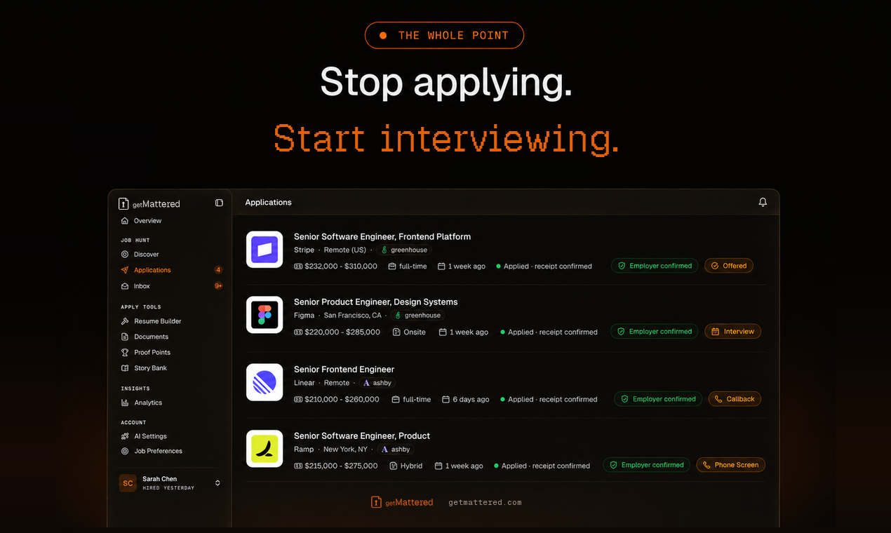

<div align="center">


# GetMattered MCP Server

**Auto-Apply That Ends on an Interview**

Find jobs that fit, tailor your resume and cover letter, and send each application on the employer's own hiring system, from the assistant you already use.



[](https://glama.ai/mcp/servers/getmattered/getmattered-mcp)
[](https://registry.modelcontextprotocol.io/v0/servers?search=getmattered)
[](LICENSE)

**[Setup](https://getmattered.com/mcps)** · **[Status](https://getmattered.com/status)** · **[Website](https://getmattered.com)** · **[Privacy](https://getmattered.com/legal/privacy)** · **[Terms](https://getmattered.com/legal/terms)**

</div>

## Quick start

Paste this into your agent:

```
Set up GetMattered for me. Follow https://getmattered.com/setup.md
```

Or add the server yourself. There is no API key. You sign in once in a browser, with Google or an email link.

```
https://mcp.getmattered.com/mcp
```

[](https://cursor.com/install-mcp?name=getmattered&config=eyJ1cmwiOiJodHRwczovL21jcC5nZXRtYXR0ZXJlZC5jb20vbWNwIn0=)
[](https://insiders.vscode.dev/redirect/mcp/install?name=getmattered&config=%7B%22type%22%3A%22http%22%2C%22url%22%3A%22https%3A//mcp.getmattered.com/mcp%22%7D)
[](https://poke.com/integrations/new?name=GetMattered&url=https%3A%2F%2Fmcp.getmattered.com%2Fmcp)

- **ChatGPT:** [open GetMattered in ChatGPT](https://chatgpt.com/plugins/plugin_asdk_app_6adce5a7d5d881918e5bba3849d7d836), add it and sign in.
- **Claude:** in Settings, open Connectors, add a custom connector, paste the address and sign in.
- **Claude Code:** `claude mcp add --transport http --scope user getmattered https://mcp.getmattered.com/mcp`, then type `/mcp` and sign in.
- **Codex:** `codex mcp add getmattered --url https://mcp.getmattered.com/mcp`, then `codex mcp login getmattered`.
- **Gemini CLI:** `gemini mcp add --transport http --scope user getmattered https://mcp.getmattered.com/mcp`, then `/mcp auth getmattered`.
- **Any other app:** add a remote MCP server at the address, as that app's docs say.

Five free applications from ChatGPT, Claude or any MCP client. Upgrade any time for more.

## Skills

This repository is also a plugin marketplace and a Gemini CLI extension, with fourteen job-search skills in `plugins/getmattered/skills`.

```bash
npx skills add https://getmattered.com -g -y
```

Claude Code: `claude plugin marketplace add getmattered/getmattered-mcp`, then `claude plugin install getmattered@getmattered`. Enable auto-update for the getmattered marketplace in /plugin > Marketplaces to receive each new release.

Claude Desktop: download `getmattered-<version>.mcpb` from the newest [GitHub release](https://github.com/getmattered/getmattered-mcp/releases/latest) and open it. On the first tool call it opens your browser once to sign in. The bundle is unsigned, and a new release means installing the new file.

Codex: `codex plugin marketplace add getmattered/getmattered-mcp`, then `codex plugin add getmattered@getmattered`.

Gemini CLI: `gemini extensions install https://github.com/getmattered/getmattered-mcp`.

## Command line and local bridge

```bash
npx getmattered-mcp login                  # sign in once
npx getmattered-mcp call <tool> '<json>'   # from a script or a bot
npx -y github:getmattered/getmattered-mcp  # stdio bridge for apps that only run local servers
```

Exit code 0 means success, 1 means the tool reported an error, and 2 means you are not signed in. `GETMATTERED_MCP_URL` overrides the endpoint.

## Watch the demo

[](https://www.youtube.com/watch?v=2uxVDG0dxQ4)

## Privacy

Your resume and profile stay on your GetMattered account. Tools read and write that account and nothing else. The [privacy policy](https://getmattered.com/legal/privacy) and [terms](https://getmattered.com/legal/terms) are the binding statement.

## Support

- Status: [getmattered.com/status](https://getmattered.com/status)
- Issues: [github.com/getmattered/getmattered-mcp/issues](https://github.com/getmattered/getmattered-mcp/issues)
- Email: support@getmattered.com

## About this repository

The hosted server runs on Cloudflare Workers and its source is not public. This repository holds the `server.json` manifest, the plugin and skills, and the small MIT licensed stdio bridge, which forwards messages verbatim. See the [changelog](CHANGELOG.md).

This repository is published from GetMattered's own repository on every release, so pull requests here are read but not merged directly. Each `v*` tag runs [the release workflow](.github/workflows/release.yml), which publishes the same version to npm (with provenance), the MCP Registry and GitHub Releases.
